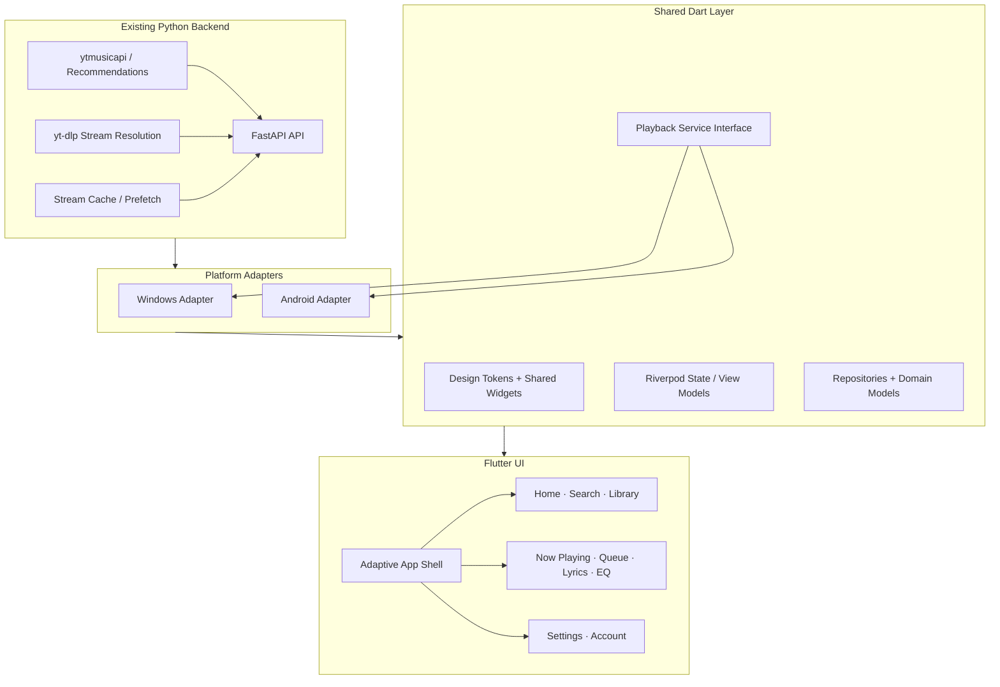

We should treat this as two connected jobs:

1. Design the entire YTM Client UI — every screen, menu, popup, panel, control, spacing rule, colour, and interaction, so the app feels like one coherent product rather than a collection of unrelated pages.
2. Move the frontend to Flutter — with Windows and Android as targets, while preserving the working YouTube Music integration, authentication, queue, recommendations, listening history, and playback behaviour wherever possible.

I’d keep your chosen direction: pure black background, dark-only v1, Apple-inspired hierarchy and motion, coral-red accent (`#FA2D48`), and no unnecessary gradients or decorative glass everywhere. Glass should be reserved for floating controls and navigation; content surfaces should remain quiet and readable.

One important architecture decision: Flutter replaces the UI and platform-specific client layer, but it does not automatically replace the audio engine or make the existing Windows audio code portable. We should migrate in stages, prove playback and authentication on both platforms, and only then retire the WinUI frontend.

# 1. The complete YTM Client map

Think of the app as five layers:

- App shell: navigation, title bar, window controls and persistent mini-player.
- Main screens: Home, Search, Library and Now Playing.
- Playback surfaces: queue, lyrics, equalizer, output device and playback options.
- Secondary screens: playlists, artists, albums, history, recommendations and settings.
- Global menus: search shortcut, context menus, keyboard shortcuts, account/authentication and error states.

## Navigation diagram

> **Reconstructed diagram — the connections are inferred.** When this document was authored,
> the diagram was pasted in as rendered output, so its connector lines were never captured and
> only the node labels survived. The block below restores those labels and re-derives the arrows
> from the prose in this section (the five layers above, §3 screens and §J overlays). Treat it as
> a reading of the written specification, not a recovered copy of the original diagram.

```mermaid
flowchart TB
    Launch(["Launch / Restore Session"])

    subgraph APP_SHELL["App shell"]
        Shell["App Shell"]
        MiniPlayer["Global Mini-player"]
    end

    subgraph MAIN_SCREENS["Main screens"]
        Home["Home"]
        Search["Search"]
        Library["Library"]
        NowPlaying["Now Playing"]
        SearchResults["Search Results"]
        SongAlbum["Song / Album / Artist / Playlist"]
    end

    subgraph PLAYBACK_SURFACES["Playback surfaces"]
        Queue["Queue"]
        Lyrics["Lyrics"]
        Equalizer["Equalizer"]
        PlaybackOptions["Playback Options"]
        OutputDevice["Output Device"]
    end

    subgraph SECONDARY_SCREENS["Secondary screens"]
        MadeForYou["Made for You"]
        RecentlyPlayed["Recently Played"]
        RecommendationRails["Music Recommendation Rails"]
        Playlists["Playlists"]
        LikedSongs["Liked Songs"]
        AlbumsArtists["Albums / Artists"]
        ListeningHistory["Listening History"]
        Settings["Settings"]
        SettingsSections["Appearance / Playback / Audio / Privacy / Shortcuts"]
    end

    subgraph GLOBAL_MENUS["Global menus"]
        Profile["Profile / Account"]
        SessionStatus["Sign-in / Session Status / Signout"]
        PlaybackContextMenu["Playback Context Menu"]
        QuickQueue["Quick Queue"]
    end

    Launch --> Shell
    Shell --> Home
    Shell --> Search
    Shell --> Library
    Shell --> NowPlaying
    Shell --> Settings
    Shell --> Profile
    Shell --> MiniPlayer
    MiniPlayer --> QuickQueue
    MiniPlayer --> PlaybackContextMenu
    Profile --> SessionStatus
    Settings --> SettingsSections
    Home --> RecommendationRails
    Home --> RecentlyPlayed
    Home --> MadeForYou
    Search --> SearchResults
    SearchResults --> SongAlbum
    Library --> Playlists
    Library --> LikedSongs
    Library --> AlbumsArtists
    Library --> ListeningHistory
    NowPlaying --> Queue
    NowPlaying --> Lyrics
    NowPlaying --> Equalizer
    NowPlaying --> PlaybackOptions
    NowPlaying --> OutputDevice
```



The key rule: the mini-player is part of the shell, not part of each page. It remains in one place while you navigate. Now Playing expands into a dedicated screen, and every song action should use the same playback service and queue.

## Desktop layout — Windows

YTM Client

Search  Ctrl+K

NAVIGATION

Home

Search

Library

Playlists

Liked Songs

Recently Played

Settings

## Good evening

FEATURED MIX

### Your music, your mood.

Large artwork and one clear play action.

### Recently played

Album / mix

Album / mix

Album / mix

Current song

Artist · Album

Conceptual desktop wireframe, not a screenshot of the current app. Artwork and song metadata are placeholders.

### Desktop measurements

| Element                 | Specification                                                           |
| ----------------------- | ----------------------------------------------------------------------- |
| Window                  | Resizable; sensible minimum content height; respect OS caption controls |
| Sidebar                 | 200 px base width; 16 px internal padding                               |
| Main content            | Flexible; 24–32 px side padding                                         |
| Page title              | 28 px, weight 700                                                       |
| Section headings        | 18 px, weight 600                                                       |
| Standard gap            | 16 px; section gap 24–32 px                                             |
| Mini-player             | 80 px total reserved bottom area, including its outer margin            |
| Main background         | `#000000`                                                               |
| Sidebar / solid surface | `#141417`                                                               |
| Raised surface          | `#1C1C21`                                                               |
| Active accent           | `#FA2D48`                                                               |

The desktop sidebar remains visible on Home, Search and Library. It can collapse only when space is genuinely constrained. In Now Playing, the sidebar can be hidden to give the music more room; a hamburger button restores navigation. The Windows title bar and caption buttons must remain functional.

## Mobile layout — Android

On compact screens, the sidebar becomes a floating bottom navigation bar. The mini-player sits above it, and Now Playing becomes a full-screen destination.

## Home

### Made for you

Personalized music and mixes

Play mix

Current song

Artist

Compact layout concept. The mini-player and navigation should avoid the Android system gesture area.

Mobile rules:

- 16 px page-side padding.
- Minimum 48×48 dp touch targets.
- Bottom navigation: Home, Search, Library.
- Mini-player directly above the navigation, with safe-area handling.
- Settings, account and less-frequent actions live in profile or overflow menus.
- Now Playing uses the available width for artwork and controls; queue and lyrics open as dedicated views or sheets, not tiny desktop-style popups.

# 2. The design system: exact colours, spacing and behaviour

## Colour tokens

These values should exist centrally in `lib/theme/tokens.dart`. Screens should reference the tokens rather than inventing their own colours.

| Token           | Value                | Use                                                            |
| --------------- | -------------------- | -------------------------------------------------------------- |
| `bg`            | `#000000`            | Main page background                                           |
| `surface`       | `#141417`            | Sidebar, solid sheets, basic panels                            |
| `raised`        | `#1C1C21`            | Cards and raised controls                                      |
| `accent`        | `#FA2D48`            | Playback progress, active states, liked items, primary actions |
| `textPrimary`   | `#FFFFFF`            | Main labels and titles                                         |
| `textSecondary` | `#A6A6A6`            | Artist names, secondary descriptions                           |
| `textTertiary`  | `#7A7A7A`            | Captions and less prominent metadata                           |
| `glass`         | White at 6% opacity  | Floating navigation and lightweight controls                   |
| `glassStrong`   | White at 10% opacity | Prominent floating controls                                    |
| `border`        | White at 10% opacity | Subtle floating-surface outline                                |
| `borderStrong`  | White at 16% opacity | Focused or more prominent outline                              |
| `scrim`         | Black at 90% opacity | Modal backdrop                                                 |

Accent rule: red is meaningful. Don't paint every icon, card and divider red. The primary play button can be white with a black glyph; the progress indicator and active state use coral red.

## Spacing, typography and shape

### Spacing scale

4

8

12

16

24

32

### Corner radii

8 px

12 px

20 px

Pill

Use Inter, with platform-appropriate fallbacks. Text scaling should be capped at 1.3× in the layout unless accessibility testing indicates a better strategy.

- Page title: 28 px / bold.
- Section title: 18 px / semibold.
- Track and card title: 14–16 px.
- Body: 14 px.
- Secondary metadata: 13 px.
- Captions: 12 px.
- Now Playing title: 24 px compact, 28 px desktop.
- Spacing: only 4, 8, 12, 16, 24 or 32 px.
- Radii: only 8, 12, 20 or pill-shaped.

## Glass rules

Glass is for things that float above content: bottom navigation, compact transport controls, context menus and floating pills. It is not a background style for every card.

A glass component should:

1. Clip to its chosen radius.
2. Blur the content behind it (around 22 sigma).
3. Apply the correct translucent fill.
4. Add a thin translucent border.
5. Avoid more than two overlapping blurred layers.
6. Fall back to a solid raised surface when transparency is disabled or performance is poor.

# 3. Every screen, menu and popup

## A. Home

Purpose: get music playing quickly without making the user navigate through layers of menus.

[‎SECRECY EP - Album by PEEKABOO - Apple Music](https://images.openai.com/static-rsc-4/_8Wl9NDTTW0ZIweajC-7IBaRBy-G1nkkGBc0sUxvX5zRJTVTyZ7jJNKydl5G0JA-hMtjvIwrwBRbEGLpALW2qEsf5Ppz4-L3A-QDta_y5FYU7RWlvHFMZhtMZqPGHPu5-6B5kjzKuVxkF3bcE8h7xkK6TDNMmue-A5DiSU7-lTo?purpose=inline)

Featured mix / recommendation

Large artwork, title, short description and a clear Play button. Desktop artwork can reach roughly 176 px; mobile can use a wider hero.

[Responsive Portfolio Website](https://images.openai.com/static-rsc-4/0WtEhasaRiaNvA4ILmJQqsDrlw1CZ9hJGwjseFk01meNbhEO69VJf-CWmTbG5tQw85lVnAvwUjKPQjeaBR-eQgqOX0MxS39aUWmkPqDdaJ_XB1Cs4yQqXo7x_uelS-xpm38Pi5Z1GuVvpirDx_7LISrTtru3KPiV_gs2-ySml3c?purpose=inline)

Recently played

Compact artwork tiles or rows. Clicking an item opens its album, playlist or artist; Play starts playback using the existing queue rules.

[Renato Cohen, AFFKT - Airy EP \[Sincopat\] | Music & Downloads on Beatport](https://images.openai.com/static-rsc-4/X2gR_aKwvQh02jb9NDJaZmvY773Jmrz5YTgI7A39IWUwKyiIE-gwm5PqJgAg1ThCTKwQ90F5ZErHek_2ynFycmplgQx5eOC_FDqW41HLxPdWoWyQh_5gCDJzrORxWtyN8iv9sYa9liKyBbJ775E66cL5tR_z_IAsxMX_NXuDpno?purpose=inline)

Recommendations and mixes

Horizontal rails on desktop and mobile, with horizontal scrolling, track menus and no unnecessary card borders.

Home should support loading skeletons, a helpful empty state, retry on error and a discreet offline state. Never display fake recommendation content as if it came from the service.

## B. Search

The search screen should be fast, focused and keyboard-friendly.

- Search field at the top; use the glass treatment sparingly.
- Search as the user types, with a 300 ms debounce.
- Show recent searches before a query is entered.
- Group results into Songs, Albums, Artists and Playlists.
- A result row has artwork, title, secondary metadata and a trailing overflow menu.
- Escape closes a suggestion layer or clears the current transient state before leaving the page.
- Ctrl+K opens Search from anywhere; keyboard focus moves straight into the input.
- Stale results from an earlier query must not overwrite results from a newer query.

When a query has no results, show “No results” and the query text, not a blank page. If the network request fails, offer Retry.

## C. Library

Use a simple header with the page title, filter chips and an optional sort control.

Filters: Playlists, Songs, Albums and Artists, plus any supported custom collections. Use 56 px rows with 48 px artwork where appropriate.

The sort menu can contain only valid, implemented choices, for example:

- Recently added
- Recently played
- Alphabetical

A row click opens the collection; Play starts it. Long-press on Android or right-click on Windows opens the same contextual actions.

## D. Song and collection context menus

Every song row, album, artist and playlist should have a consistent overflow menu. Only show actions relevant to that item.

Play now

Starts playback according to the selected item and queue rules.

Play next

Inserts the item after the current track without discarding the remaining queue.

Add to queue

Adds the item to the end of the queue.

Like / Remove like

Reflects the real persisted state, not a temporary visual toggle.

Go to album / artist

Opens the corresponding detail screen when metadata is available.

Copy link / Share

Available only when a valid share URL exists.

For playlists, also include Rename, Edit playlist, Remove from library or Delete playlist only when those actions are supported. Destructive actions require confirmation. Never display a menu item that is merely a placeholder.

## E. Now Playing — the main event

NOW PLAYING

## Song title

Artist · Album

1:24

3:58

Layout concept only. Desktop uses more space and can show a three-card artwork carousel; mobile retains the same controls and hierarchy in a single-column layout.

### Scrubber: fix the existing seeking problem

The progress bar must be a real interactive control, not just a visual indicator.

- Tapping or clicking a position seeks to that time.
- Dragging updates a temporary seek preview; release commits the seek.
- Windows mouse hover grows the bar from 4 px to 8 px.
- Android supports touch dragging with a comfortably large invisible hit area.
- Show current time and duration at the ends.
- Display buffered progress separately from played progress.
- Disable seeking when duration is unknown or the stream cannot seek; show a clear state rather than pretending the action worked.
- Update the UI optimistically, then reconcile with the actual playback position.
- Seeking must not accidentally trigger play/pause.
- Test rapid repeated seeks, seeking near the end, unknown duration and streams that do not support range requests.

### Transport controls

| Control      | Behaviour                                                                          |
| ------------ | ---------------------------------------------------------------------------------- |
| Previous     | Restart the current track when appropriate; otherwise play the previous queue item |
| Play / Pause | Always reflects the real playback state                                            |
| Next         | Advances through the queue; respects repeat and shuffle                            |
| Shuffle      | Toggle persists and changes queue selection                                        |
| Repeat       | Cycles Off → Repeat All → Repeat One                                               |
| Like         | Updates the actual saved/liked state                                               |
| Queue        | Opens the queue without stopping playback                                          |
| Lyrics       | Opens synced lyrics when available                                                 |
| EQ           | Opens equalizer controls                                                           |
| Output       | Opens supported audio output options                                               |

On desktop, the three-card artwork carousel belongs in Now Playing only when the window is wide enough. On mobile, use the same carousel interaction adapted to the available width, with swipe gestures and no cramped side cards.

## F. Queue

The queue is a dedicated screen or panel, not just a list in a popup.

- Current song is clearly highlighted.
- Upcoming tracks appear below it.
- Drag handles reorder tracks; keyboard-accessible move actions must also exist.
- Track context menus reuse the standard actions.
- Provide Clear queue with confirmation.
- Autoplay has a visible on/off state.
- When shuffle is enabled, distinguish the current play order from the underlying collection if the service supports that distinction.
- Queue changes must be reflected in the mini-player and Now Playing immediately.

## G. Lyrics

- Current line is white and prominent.
- Previous and upcoming lines are dimmed.
- Synced lyrics scroll automatically with the current line.
- Tapping a timestamped line seeks to it.
- Manual scrolling temporarily pauses auto-follow; a “Back to current line” action restores it.
- If lyrics are unavailable, show a simple explanation and a route back to Now Playing.

Do not invent synchronized timestamps when the provider supplies none.

## H. Equalizer

Use a dedicated screen or sheet with:

- An on/off switch.
- Preset selection.
- Ten vertical frequency sliders.
- Reset to flat.
- Clear current preset name.
- Persisted settings.

EQ must change the actual audio output. If the selected platform or audio path cannot apply the EQ, explain that limitation; do not render working-looking sliders that do nothing.

## I. Settings

Use a settings page with grouped sections and secondary detail pages.

| Section            | Controls                                                    |
| ------------------ | ----------------------------------------------------------- |
| Appearance         | Dark theme for v1, text scaling, reduce motion/transparency |
| Playback           | Autoplay, shuffle behaviour, supported playback options     |
| Audio              | Output device, volume behaviour, equalizer                  |
| Cache & storage    | Cache size, clear cache, storage usage                      |
| Account            | Sign-in status, refresh session, sign out                   |
| Keyboard shortcuts | View and customize supported shortcuts                      |
| Privacy            | Explain local session storage and diagnostic logging        |
| About              | App version, diagnostics, open-source notices               |

Do not put authentication cookies in settings or expose them in logs. Keep credentials in platform-secure storage where possible. Any diagnostics screen should redact session values, authorization headers, and sensitive URLs.

## J. Global menus and overlays

| Surface                | Contents and behaviour                                                     |
| ---------------------- | -------------------------------------------------------------------------- |
| Profile menu           | Account status, sign-in, sign out, Settings                                |
| Hamburger / navigation | Home, Search, Library, Settings; closes after navigation                   |
| Mini-player menu       | Queue, lyrics, EQ, playback options                                        |
| Volume menu            | Volume slider and supported output choices                                 |
| Repeat/shuffle         | Toggle state is visible and accessible                                     |
| Confirmation dialog    | Only for destructive or consequential actions                              |
| Toast / snackbar       | Short confirmation or failure; never the only way to recover from an error |
| Loading overlay        | Only for blocking operations; ordinary browsing stays interactive          |
| Error state            | Plain explanation, Retry and a safe way back                               |
| Offline state          | Clearly distinguishes cached content from unavailable content              |

Context menus should use the same spacing and surface styles across the app: 44 px rows, 12 px radius, subtle border and an opaque-enough backdrop for legibility.

## Keyboard shortcuts

| Shortcut              | Action                                                                |
| --------------------- | --------------------------------------------------------------------- |
| Space                 | Play / pause when no text field is focused                            |
| Ctrl+K                | Focus global search                                                   |
| Left / Right arrows   | Seek when focus is not in a text field or another interactive control |
| Up / Down arrows      | Volume adjustment where supported                                     |
| Alt+Left / Mouse Back | Navigate back                                                         |
| Escape                | Close the topmost menu, sheet or dialog                               |
| Ctrl+Q                | Quit on Windows, if appropriate for the app's conventions             |

Shortcuts must not steal input from text fields, and each should be documented in the shortcuts settings page.

# 4. Now, the Flutter migration

The target should be Flutter + Dart for the client UI, with platform-specific audio and authentication adapters. Flutter is a UI framework, not a drop-in replacement for the audio engine.

## Target architecture

> **Reconstructed diagram — the connections are inferred.** As with the navigation diagram, the
> original was pasted in as rendered output and its connectors were lost. The clusters and labels
> below are the document's own; the arrows are inferred from the prose in this section (the target
> architecture and the migration table that follows).



### What should stay and what must change

| Existing component                               | Migration decision                                                                           |
| ------------------------------------------------ | -------------------------------------------------------------------------------------------- |
| WinUI 3 / XAML frontend                          | Replace incrementally with Flutter screens                                                   |
| C# MVVM and WinUI navigation                     | Rebuild using Dart, Riverpod and `go_router`                                                 |
| Python FastAPI service                           | Preserve initially; keep API contracts stable                                                |
| `ytmusicapi` and recommendation algorithms       | Preserve where compatible and tested                                                         |
| `yt-dlp` stream resolution and prefetch          | Preserve initially; verify subprocess and packaging on each platform                         |
| Windows NAudio / Media Foundation path           | Replace behind a playback abstraction with a Flutter-compatible Windows audio implementation |
| Windows-specific authentication such as `winreg` | Move behind a platform-specific authentication interface                                     |
| Android authentication                           | Implement and test separately; do not assume the Windows cookie workflow transfers           |
| Secure session storage                           | Use platform-appropriate secure storage; never send browser cookies to your VPS              |
| Existing tests                                   | Preserve backend regression tests; add Dart tests and platform integration tests             |

For the audio layer, evaluate `just_audio` and `audio_service` for Android and `media_kit` for Windows as candidates. Before committing to either, verify current package support, seeking/range behaviour, playback lifecycle, background playback needs and packaging requirements. The UI should talk to a `PlaybackService` interface, never directly to platform audio code.

## Migration phases

1. Phase 0 — Audit and protect the working version

   Freeze the current known-good Windows implementation. Inventory every API endpoint, playback transition, auth flow, setting, keyboard shortcut and test. Keep the current Windows app available while Flutter is developed on a separate branch.
2. Phase 1 — Prove the two biggest risks

   Build a tiny Flutter Windows and Android proof of concept that authenticates safely, resolves a real track, starts playback, seeks, pauses, skips and disposes the audio session correctly. Do this before building all the screens.
3. Phase 2 — Design tokens and primitives

   Create `lib/theme/tokens.dart`, typography, spacing, radii, `GlassSurface`, buttons, sliders, artwork tiles, track rows and context menus. Add widget tests for their states.
4. Phase 3 — App shell

   Implement responsive Windows title bar, left sidebar, persistent mini-player, Android bottom navigation, safe areas, global routing and keyboard shortcuts.
5. Phase 4 — Screens and menus

   Implement Home, Search, Library, Now Playing, Queue, Lyrics, EQ, Settings and all item menus using shared widgets and real backend calls.
6. Phase 5 — Playback and feature parity

   Verify queue manipulation, repeat, shuffle, Autoplay, recommendations, history, seeking, cache/prefetch, audio-device behaviour and recovery from network or stream errors.
7. Phase 6 — Visual and release gate

   Capture screenshots at 390×844, 900×700 and 1280×800. Add golden tests for Home, Search, Library, Now Playing, Queue and EQ. Run backend tests, Dart tests, Windows integration tests and Android integration tests before retiring the old frontend.

Important: the existing app should not be deleted or replaced in one enormous change. Keep the working Windows app as a fallback until the Flutter build passes real playback and sign-in tests on both platforms.

## Suggested Flutter project structure

```
lib/
  main.dart
  app.dart
  theme/
    tokens.dart
    typography.dart
  core/
    routing/
    platform/
    errors/
    logging/
  models/
  repositories/
  services/
    api_client.dart
    playback_service.dart
    queue_service.dart
  features/
    home/
    search/
    library/
    now_playing/
    queue/
    lyrics/
    equalizer/
    settings/
    account/
  shared/
    widgets/
      glass_surface.dart
      track_row.dart
      artwork_tile.dart
      playback_controls.dart
      progress_scrubber.dart
      context_menu.dart
      mini_player.dart
```

All spacing, colours, radii, font styles, animation values and responsive breakpoints should be centralized. No screen should introduce its own random hex colour, corner radius or spacing value.

# 5. What I would implement first

The first actual implementation milestone should not be the Home screen. It should be the small, ugly-but-working Flutter playback proof of concept:

1. Launch Flutter on Windows and Android.
2. Sign in through a safe, platform-appropriate flow.
3. Play a real YouTube Music track.
4. Pause, resume, seek by dragging and skip tracks.
5. Verify queue state survives screen navigation.
6. Confirm credentials are not logged or exposed.
7. Run the existing Python test suite unchanged.

Once that passes, build the tokens and shell, then the screens in the order above. That avoids creating a beautiful UI around an audio path that later has to be redesigned.
